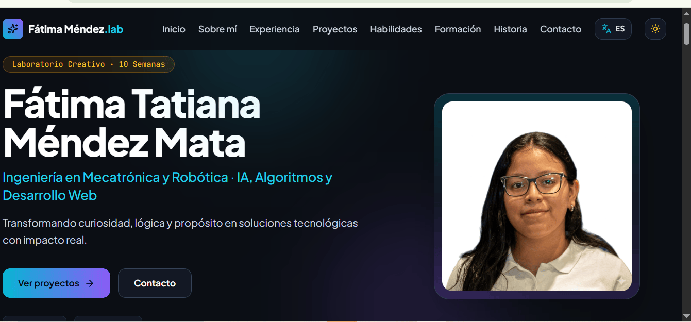

# Portafolio Digital — Fátima Tatiana Méndez Mata

## Descripción General

Portafolio web bilingüe (Español / Inglés) desarrollado con **Next.js 14**, **TypeScript** y **Tailwind CSS**, y desplegado en **Vercel**. En él presento mi perfil, trayectoria académica y liderazgo, proyectos y actividades obligatorias de las 10 semanas (Regresión Lineal, Laberinto en Python, AI Challenge con K-Means y KNN, Hotspots Comerciales y desarrollo web/backend), presencia en medios y formulario de contacto conectado a la ruta `POST /api/contact`.

## Captura de Pantalla del Portafolio




## Tecnologías Utilizadas

* **Frontend:** Next.js 14, React, TypeScript, Tailwind CSS
* **Backend / API:** Next.js API Route (`POST /api/contact`), validación de datos y variables de entorno
* **Ciencia de Datos & Machine Learning:** Python, Pandas, Scikit-learn, Matplotlib, K-Means, KNN, Google Colab
* **Algoritmos & Robótica:** Python, Pygame, estructuras/búsqueda de rutas, C++ / Arduino
* **Control de Versiones y Despliegue:** Git, GitHub, Vercel

## Instrucciones de Instalación

1. Clona el repositorio desde GitHub:
   ```bash
   git clone [https://github.com/tatianadeveloper135/Portafolio_F-tima_M-ndez.git](https://github.com/tatianadeveloper135/Portafolio_F-tima_M-ndez.git)
   ```
2. Entra a la carpeta del proyecto:
   ```bash
   cd Portafolio_F-tima_M-ndez
   ```
3. Instala las dependencias del proyecto:
   ```bash
   npm install
   ```
4. Configura las variables de entorno creando un archivo `.env.local` en la raíz del proyecto (sin subirlo a Git) y añadiendo también las variables correspondientes en **Vercel → Settings → Environment Variables**:
   ```env
   CONTACT_RECEIVER_EMAIL=fatima09mata@gmail.com
   RESEND_API_KEY=tu_api_key_de_resend
   ```

## Instrucciones para Ejecutar el Proyecto

* **Modo desarrollo (local):**
  ```bash
  npm run dev
  ```
  Luego abre `http://localhost:3000` en tu navegador.
* **Compilación y modo producción:**
  ```bash
  npm run build
  npm start
  ```

## Enlace al Portafolio Desplegado

* **Sitio en vivo (Vercel):** [https://portafolio-f-tima-m-ndez.vercel.app](https://portafolio-f-tima-m-ndez.vercel.app)
* **Repositorio en GitHub:** [https://github.com/tatianadeveloper135/Portafolio_F-tima_M-ndez](https://github.com/tatianadeveloper135/Portafolio_F-tima_M-ndez)

## Lo Aprendido Durante el Desarrollo

Durante estas 10 semanas aprendí a estructurar una aplicación web moderna con **Next.js**, **React** y **TypeScript**, cuidando la organización por componentes, datos y traducciones (`ES`/`EN`). También reforzé la depuración de rutas de archivos estáticos (`public/images/`), el manejo de variables de entorno y la integración con endpoints (`POST /api/contact`), además de aplicar conceptos de análisis de datos y Machine Learning en proyectos prácticos y trabajar con flujo continuo en Git, GitHub y Vercel.